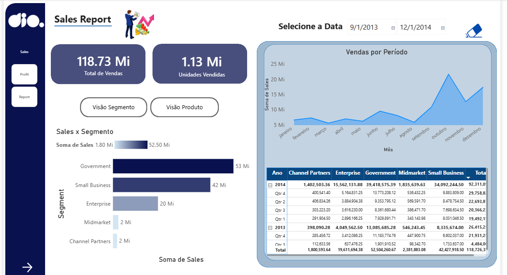
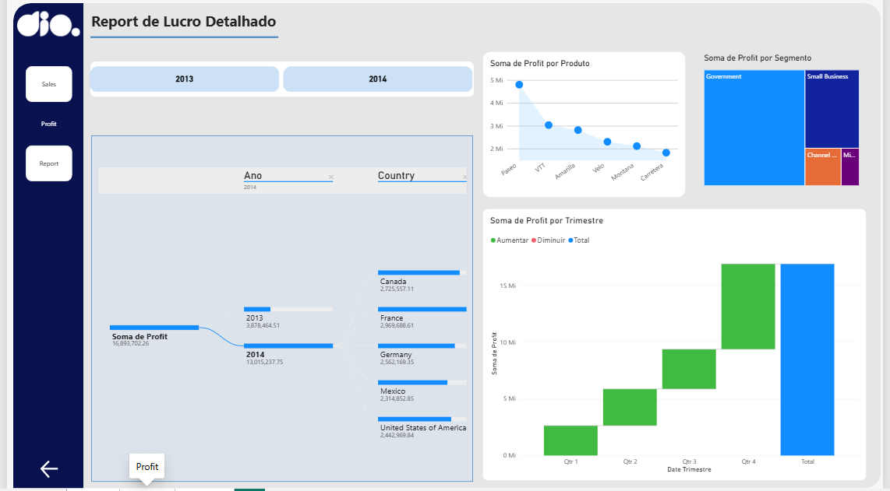
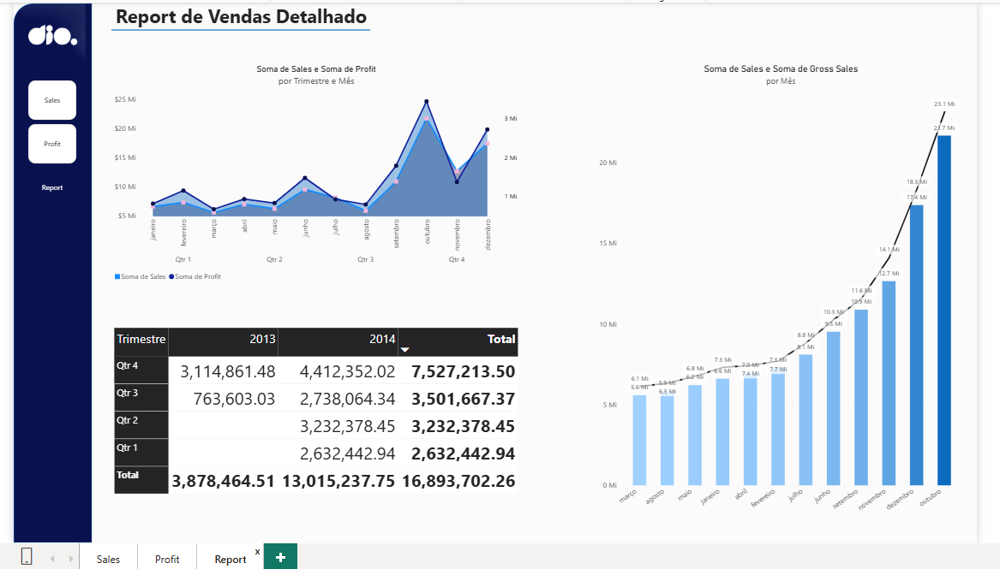

# 📊 Relatório Gerencial de Vendas — Power BI

## 📌 Sobre o Projeto

Projeto desenvolvido durante a Formação Power BI Analyst da DIO, com o objetivo de melhorar a visualização dos dados de vendas e lucros, aplicando conceitos de UX para deixar o relatório mais organizado e fácil de entender.

O dashboard possui 3 páginas interativas: Sales, Profit e Report.

## 📈 Dashboards

### 1. Sales — Vendas

Apresenta os principais indicadores de vendas, como total vendido, unidades vendidas, vendas por segmento e evolução mensal. Também possui filtros por data e botões de navegação.

### 2. Profit — Lucro

Mostra a análise dos lucros por produto, segmento, país e trimestre, utilizando diferentes gráficos para facilitar a comparação dos resultados.

### 3. Report — Relatório Detalhado

Reúne informações mais detalhadas sobre vendas e lucros, com comparações mensais, trimestrais e anuais.

## 🛠️ Ferramentas Utilizadas

- Power BI Desktop
- Power Query
- Visualização de Dados
- Conceitos de UX

## 📚 Aprendizados

Neste projeto, pratiquei a criação e organização de dashboards, utilização de filtros, navegação entre páginas e escolha de gráficos para apresentar os dados de forma mais clara.

Também trabalhei com posicionamento, contraste e organização dos elementos visuais.

## 📂 Arquivo do Projeto

O arquivo completo está disponível para download e pode ser aberto no Power BI Desktop.

📊 **[Clique aqui para acessar ou baixar o projeto Power BI](Relatorio_Gerencial_de_Vendas.pbix)**

## 👩‍💻 Autora

**Deborah Calixto**

Projeto desenvolvido como parte da Formação Power BI Analyst — DIO.

